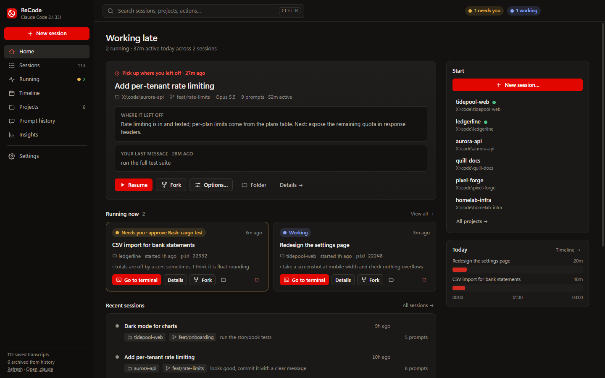

# ReCode

**Pick up exactly where you left off in Claude Code.** · [Website](https://nebula3141.github.io/recode/)



A Windows desktop app for picking up Claude Code work. It lists every Claude Code session on this PC, shows what each one was doing and when, and resumes any of them in a terminal with one click.

## What it does

- **Home** — the session you most recently left (with Claude's "where it left off" recap and your last message), sessions running right now, recent sessions, quick-start folders, presets, and today's activity.
- **Sessions** — every session, grouped by day. Search titles, prompts, edited files and your notes. Filter by running/resumable/archived, time range and project. The detail pane shows the recap, stats (active time, prompts, tool calls, tokens, model, lines changed, compactions), the full conversation, every prompt, and every file Claude edited.
- **Running** — live Claude Code processes with their state (working, needs you, idle), refreshed every few seconds.
- **Timeline** — a year heatmap, plus a per-day chart of which sessions were active at what time, plus that day's prompts.
- **Projects** — every folder you've used Claude Code in, with New session / Resume latest.
- **Prompt history** — every prompt you've typed, including sessions whose transcripts Claude Code has since cleaned up.
- **Insights** — active hours per day, when you work, where your time went, tools and models used.

**Resume** opens Windows Terminal (or a PowerShell window) in the session's folder and runs `claude --resume <id>`. **Fork** runs `claude --resume <id> --fork-session`. **Options…** lets you choose the model, permission mode, effort, a message to send, Remote Control, extra directories and raw CLI flags, with a live preview of the exact command. Double-click any session to resume it.

Keyboard: `Ctrl K` search everything · `N` new session · `/` search · `J`/`K` move · `Enter` resume · `F` fork · `P` pin · `O` open folder · `Esc` close.

## Where the data comes from

Read-only, from `%USERPROFILE%\.claude`:

| Source | Used for |
|---|---|
| `projects\*\<session-id>.jsonl` | transcripts: titles, prompts, recaps, tokens, tools, files, timing |
| `sessions\<pid>.json` | which sessions are running now and their status (cross-checked with the process list) |
| `history.jsonl` | prompt history, including sessions whose transcripts were deleted ("archived") |
| `%USERPROFILE%\.claude.json` | the list of known project folders |

The launcher never writes into `.claude`. Its own state (pins, notes, tags, renames, presets, settings, index cache) lives in `%APPDATA%\ReCode\data` (or `%APPDATA%\Claude Launcher\data` if you used the app under its earlier name). Transcripts are indexed incrementally, so only new lines are read after the first run.

## Install

**Installer:** download `ReCode-Setup-<version>.exe` from [Releases](https://github.com/nebula3141/recode/releases). It installs for your user only (no admin), adds Start menu and Desktop shortcuts, and registers an uninstaller in Settings > Apps.

**PowerShell, one line:**

```powershell
irm https://raw.githubusercontent.com/nebula3141/recode/main/install.ps1 | iex
```

This downloads the portable zip from the newest release, checks its SHA-256 against `SHA256SUMS.txt`, installs to `%LOCALAPPDATA%\Programs\ReCode`, and adds shortcuts and a Settings > Apps entry. Options: `-Version 1.0.0-rc.1`, `-Prerelease`, `-NoDesktopShortcut`. To remove it: Settings > Apps > ReCode, or `uninstall.ps1` (add `-RemoveData` to also delete your pins, notes and settings).

**Portable:** unzip `ReCode-<version>-win-x64.zip` anywhere and run `ReCode.exe`.

Builds are not code-signed yet, so Windows SmartScreen may warn on first run (More info → Run anyway).

## Build from source

```powershell
npm install
npm start                 # run from source
npm run release           # installer, zip, install scripts and SHA256SUMS.txt in release\<version>\
npm run package           # quick local build: dist\ReCode-win32-x64\ReCode.exe
npm run shortcuts         # Start menu + Desktop shortcuts to that local build
```

Requires Node.js to build, and Claude Code (`claude`) on PATH (or set its full path in Settings). Windows Terminal is used when installed; otherwise sessions open in a PowerShell window.

## Layout

```
electron/main.js      window, IPC, live-update ticker
electron/preload.js   narrow bridge exposed to the UI as window.launcher
lib/indexer.js        incremental transcript + history indexer
lib/service.js        derived views (sessions, projects, activity, search) and request router
lib/launch.js         terminal launching (argument-exact via -EncodedCommand), OS actions
lib/live.js           running-session detection
lib/store.js          launcher settings, pins/notes/tags, presets
public/               the UI (plain HTML/CSS/JS, no build step)
scripts/              icon generation, packaging, shortcut installer, demo data
docs/                 the project website (GitHub Pages)
```

Debug: `npm start -- --shot=out.png --route=sessions` renders a view to a PNG and exits (`--js-file=check.js` runs a script in the page first). `F12` opens DevTools, `Ctrl R` reloads.

Demo data: `node scripts/demo-data.js <folder> [--live]` writes a fictional `.claude` folder; run the app with `CLAUDE_CONFIG_DIR=<folder>\.claude` to see it. The screenshots here were made that way.

## License

MIT. An independent project, not affiliated with Anthropic.
